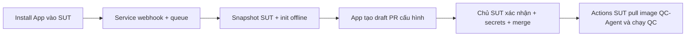

# GitHub App chỉ thay init

App chỉ cài vào **SUT**. Service onboarding nhận sự kiện install/thêm repo, chạy scanner/generator rule-based và tạo draft PR trong SUT. Sau merge, Actions của SUT pull image QC-Agent từ GHCR và chạy pipeline như trước. App không dispatch workflow trong QC-Agent và không cần quyền Actions ở repo QC-Agent.



## Trạng thái

Code: `tools/github_app_service.py`, `tools/github_app.py` và `deploy/github-app/Dockerfile`. Chưa deploy service, chưa verify install → PR trên GitHub thật. LLM chưa được bật. Scanner còn có thể yêu cầu xác nhận DB, port, health route và OpenAPI; tạo PR không chứng minh baseline QC đã xanh.

Service Python chạy được generator hiện có, thay cho bridge Cloudflare chỉ dispatch workflow ở bản trước. Có thể host container trên máy/server riêng hoặc nền tảng container có HTTPS và lưu trữ bền. Cloudflare Worker cũ và workflow onboarding tập trung đã được bỏ. Worker JS thuần không tự chạy generator Python/Git này.

## Cấu hình GitHub App

- Chỉ cần install App vào SUT sandbox.
- Repository permissions: Contents **Read & write**, Pull requests **Read & write**, Workflows **Read & write** (vì PR chứa `.github/workflows`). Metadata đọc mặc định.
- Không cần Actions/Checks cho bước init. Report vẫn dùng workflow/GITHUB_TOKEN hiện tại của SUT.
- Dùng lifecycle events `installation` (created) và `installation_repositories` (added). Không cần PR webhook hoặc OAuth callback ở mốc này.
- Lấy App ID và private key PEM từ trang App; không commit hoặc gửi private key qua chat.
- Điền URL service `/webhook`, bật Active và đặt webhook secret trùng cấu hình service. Nếu App đã install trước khi service sẵn sàng, redeliver delivery installation hoặc thêm SUT vào installation để bắt đầu.

## Cấu hình service

Copy `deploy/github-app/service.env.example` vào file local nằm ngoài Git, ví dụ `runs/github-app-service.env`. Điền:

| Variable | Ý nghĩa |
|---|---|
| `QC_APP_ID` | App ID |
| `QC_APP_PRIVATE_KEY_FILE` | Đường dẫn PEM được mount read-only trong container |
| `QC_WEBHOOK_SECRET` | Secret webhook ngẫu nhiên, giống GitHub App |
| `QC_WORKFLOW_REPOSITORY` | Repo public chứa reusable workflow QC-Agent; **không cần install App vào repo này** |
| `QC_WORKFLOW_REF` | SHA40 đã publish, có input `ghcr_username` |
| `QC_IMAGE` | Image đã publish, ghim `@sha256:...`, dùng trong workflow SUT |
| `QC_QA_OWNER` | QA CODEOWNER, ví dụ `@MinhDuc-IT` |
| `GHCR_USERNAME` | Chủ PAT kéo image private trong SUT; không dùng tên App bot |
| `QC_ONBOARD_DB` | SQLite queue, mặc định `/data/onboarding.sqlite` |

PEM truyền qua file mount; nếu hạ tầng có secret manager hỗ trợ multiline thì có thể đặt `QC_APP_PRIVATE_KEY` thay cho file. Service không cần PAT/GHCR_PULL_TOKEN trong runtime: nó không pull/chạy worker image cho từng SUT. Người triển khai cần Docker login khi build/pull runtime private. SUT vẫn phải tự đặt `GHCR_PULL_TOKEN` nếu workflow dùng image private.

Build từ root QC-Agent:

```powershell
docker build -f deploy/github-app/Dockerfile --build-arg QC_RUNTIME=ghcr.io/minhduc-it/qc-agent@sha256:<RUNTIME_DIGEST> -t qc-agent-onboarding:local .
```

Chạy một container, mount private key read-only và named volume `/data`, nạp file env local, publish cổng `127.0.0.1:8080:8080`. Dùng reverse proxy HTTPS hoặc HTTPS tunnel cho thử nghiệm để GitHub truy cập `/webhook`; `/healthz` kiểm tra tiến trình. Không ghi key vào image/Dockerfile. **Chỉ một process/replica trên một SQLite volume**; nếu cần scale phải thay queue/lease trước. Queue giữ delivery/job bền, retry tối đa 10 lần; failed jobs kiểm tra bằng quyền quản trị trên SQLite/log nội bộ, không có endpoint public đọc dữ liệu queue.

## Service làm gì

1. Xác thực chữ ký webhook trên bytes gốc và lưu job, dedup theo delivery/repo.
2. Xác nhận installation vẫn đúng, cấp token chỉ cho repo SUT.
3. Git fetch snapshot bằng `clone --no-checkout` + archive: không chạy hook, checkout filter, Dockerfile, script SUT hoặc LLM. Token chỉ truyền qua environment header, không ghi vào remote URL hoặc log.
4. Chỉ nhận file thường, từ chối symlink/special file/path traversal, giới hạn snapshot 100 MB/20.000 entry và 20 MB/file. Repo không phù hợp cần onboarding thủ công. Git fetch có timeout; giới hạn snapshot áp dụng sau fetch, chưa phải quota mạng cứng.
5. Gọi generator init trực tiếp, giữ file đã có, gom vùng CODEOWNERS được quản lý, chỉ đưa thay đổi `.qc-agent/**`, `.github/**` hoặc CODEOWNERS vào Git tree.
6. Tạo commit/branch/PR qua GitHub Git Data API, không force-push. Thu hồi token sau xử lý.

PR mở sẵn được giữ nguyên để không ghi đè QA. Nếu branch `qc-agent/onboarding` đã tồn tại nhưng không có PR mở, service dừng để người vận hành kiểm tra (gồm trường hợp tạo branch xong nhưng API tạo PR thất bại); không tự xoá/reset nhánh. Không tự merge, cấp secrets hoặc đặt branch protection.

## Kiểm chứng thật

- Chữ ký sai không có job; delivery lặp chỉ có một job.
- Install/thêm SUT tự có draft PR vào đúng default branch, không có workflow chạy trong QC-Agent.
- Review TODO/DB/health/suites/CODEOWNERS; đặt test-only secrets trong SUT.
- Merge xong: SUT Actions pull image và baseline xanh. Sau đó cấu hình required checks/QA review nếu muốn enforce merge.
- Không tick PASS cho install E2E hay metric LLM từ test mock/offline.

Tham chiếu: [GitHub App tokens](https://docs.github.com/en/apps/creating-github-apps/authenticating-with-a-github-app/generating-an-installation-access-token-for-a-github-app), [webhook signatures](https://docs.github.com/en/webhooks/using-webhooks/validating-webhook-deliveries).
