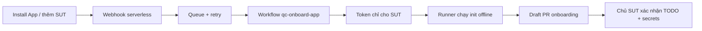

# GitHub App onboarding — milestone 1

Nhánh triển khai: `app-llm`. Hiện có code onboarding và webhook bridge; chưa có GitHub App đã đăng ký, chưa deploy endpoint và chưa có evidence E2E thật. OpenAI, chuyển report sang App bot và đo metric LLM là các mốc tiếp theo, chưa được triển khai ở mốc này.

## 1. Tạo App

Mở GitHub Settings → Developer settings → GitHub Apps → New GitHub App, dưới tài khoản/org quản lý QC-Agent.

- Tên: tên duy nhất, ví dụ `qc-agent-sandbox-<tên của bạn>`.
- Homepage URL: URL repo QC-Agent.
- Webhook: tạm tắt Active khi chưa có endpoint; sau deploy bật lại và điền URL `/webhook` cùng secret ngẫu nhiên.
- Không cần user OAuth callback ở milestone này.
- Repository permissions: Contents **Read & write**, Pull requests **Read & write**, Workflows **Read & write**, Actions **Read & write**. Metadata là quyền đọc mặc định. Checks **Read & write** chỉ cần khi triển khai App report ở milestone sau.
- Installation và installation_repositories là các sự kiện lifecycle App dùng để onboarding. Chưa cần subscribe pull_request vì QC vẫn chạy qua workflow trong SUT.
- Nếu SUT khác chủ repo QC-Agent, chọn phạm vi cài App cho các account cần dùng; thử nghiệm chỉ chọn các repo sandbox.

Sau khi tạo, ghi lại App ID và Generate a private key. **Không gửi PEM hoặc token qua chat và không commit.** Install App vào cả repo điều phối QC-Agent và SUT. Token của control repo chỉ dùng dispatch; token onboarding chỉ có Contents/PR/Workflows của đúng SUT.

## 2. Chuẩn bị workflow điều phối

Workflow `.github/workflows/qc-onboard-app.yml` phải có trong **default branch** của repo QC-Agent để GitHub chấp nhận workflow_dispatch. Có thể chọn ref `app-llm` khi chạy sau khi nhánh đó được push. Chưa merge/push workflow mới tự động trong milestone này; phải qua review repo QC-Agent.

Tạo environment `github-app-onboarding` trong repo QC-Agent. Giai đoạn sandbox nên có required reviewer; muốn install tự chạy về sau thì quyết định riêng việc bỏ bước duyệt environment. Giới hạn nhánh được chạy ở environment này cho các nhánh được tin cậy.

Variables của environment:

| Name | Value |
|---|---|
| `QC_APP_ID` | App ID |
| `QC_ONBOARD_IMAGE` | Image QC-Agent đã publish, **ghim digest** |
| `QC_ONBOARD_REF` | SHA40 của QC-Agent **đã push**, chứa reusable workflows cần dùng |
| `GHCR_USERNAME` | Chủ PAT kéo GHCR (chỉ cần nếu image private) |

Secrets của environment:

- `QC_APP_PRIVATE_KEY`: toàn bộ nội dung PEM do GitHub cấp.
- `GHCR_PULL_TOKEN`: token read:packages nếu image private. Đây là credential cho runner điều phối; SUT vẫn cần credential của nó khi chạy gate.

Khi dùng image private, generator truyền `ghcr_username` từ `GHCR_USERNAME` vào cả gate và GT workflow. Không dùng tên App bot để login bằng PAT của người khác. SHA `QC_ONBOARD_REF` phải chứa input `ghcr_username` mới trong reusable workflows; không ghim về commit cũ chưa có input đó.

Workflow mount mã nguồn generator từ ref đang chạy vào image runtime, để proposal dùng đúng phiên bản source của nhánh. Không gọi LLM, không chạy Dockerfile/SUT scripts, không force-push, không dùng `--force` với init.

Thử **thủ công trước**: Actions → QC App onboarding → Run workflow → chọn nhánh `app-llm`, nhập `MinhDuc-IT/full-stack-fastapi-template`, QA owner `@MinhDuc-IT`. Repo đã onboard có thể không tạo thay đổi; nên dùng SUT sandbox sạch để kiểm chứng lần đầu.

Workflow tạo draft PR ở nhánh `qc-agent/onboarding`. PR đang mở được tái sử dụng, không ghi đè chỉnh sửa của QA. Nếu nhánh đã có nhưng không còn PR mở, workflow dừng để người dùng kiểm tra; không xoá hay reset nhánh.

## 3. Chuẩn bị webhook serverless

Có bản tham chiếu Cloudflare Worker + Durable Object tại `deploy/github-app/`. Chưa deploy và chưa chọn/bật dịch vụ tính phí thay người dùng. Cần tài khoản Cloudflare với khả năng sử dụng Workers/Durable Objects; kiểm tra điều kiện tài khoản trước khi deploy.

Điền `wrangler.toml`: App ID, repo điều phối, **installation ID của App trên repo điều phối**, ref đã push và QA owner. Installation ID không phải App ID; lấy từ trang cấu hình installation hoặc API GitHub App. QA owner là cấu hình được tin cậy của deployment, không lấy từ payload SUT.

Đặt secrets Worker qua công cụ quản lý secret:

- `QC_WEBHOOK_SECRET`: chuỗi ngẫu nhiên, trùng secret cấu hình webhook GitHub App.
- `QC_APP_PRIVATE_KEY_PKCS8`: private key chuyển sang PKCS8, vì Web Crypto nhận định dạng này. Ví dụ chạy local `openssl pkcs8 -topk8 -nocrypt -in app.private-key.pem -out app.private-key.pkcs8.pem`; hai file đều phải nằm ngoài Git và được quản lý như secret.

Triển khai bằng Wrangler theo cấu hình đã review. Điền `https://<worker>/webhook` vào GitHub App, bật Active. Test bằng thêm SUT mới vào installation hoặc redeliver sự kiện installation sau khi workflow điều phối đã sẵn sàng.

Webhook trả 202 sau khi lưu queue, chưa có nghĩa onboarding đã thành công. Alarm xử lý tối đa 5 dispatch/job mỗi lượt và retry khi GitHub lỗi. Bản ghi delivery giữ 7 ngày. Dispatch có thể lặp khi lỗi xảy ra sau khi GitHub nhận request; workflow concurrency và tra PR hiện có xử lý lặp ở phía runner. Theo dõi Worker logs và Actions để xác nhận kết quả cuối cùng.

## 4. Kiểm chứng

- Chữ ký sai: 401 và không kích hoạt Actions.
- Install hoặc thêm repo: tự có workflow điều phối, checkout đúng default branch, PR nháp vào đúng branch đó.
- Gửi lại cùng delivery: không dispatch thêm; dispatch lặp vẫn không ghi đè PR.
- Secrets không xuất hiện trong artifact, PR hoặc log.
- Kiểm tra TODO, DB, health route, các suite, CODEOWNERS và secrets SUT trước merge.
- Khi image private, kiểm tra quyền GHCR và login cho cả runner điều phối lẫn gate SUT. Onboarding proposal không tự cấp secrets hoặc quyền package cho SUT.
- Merge xong: xác nhận baseline xanh và cấu hình required check/QA review ở branch protection. Onboarding PR được tạo không chứng minh gate đã chạy end-to-end.

## 5. Các mốc sau

1. Report bằng App bot: bổ sung cấp token trong SUT workflow, chọn một bên đăng check/review, bảo đảm đúng commit SHA và không trùng.
2. OpenAI Selector: provider riêng, key SUT `QC_DIFF_OPENAI_API_KEY`, rule floor + full-set fallback, usage/cost thực.
3. OpenAI GT: key `QC_GT_OPENAI_API_KEY`, PRD → draft TC → QA → gate; chỉ bật khi cho phép gửi dữ liệu và có ngân sách.

Tài liệu tham chiếu: [GitHub workflow_dispatch](https://docs.github.com/en/actions/how-tos/manage-workflow-runs/manually-run-a-workflow), [installation tokens](https://docs.github.com/en/apps/creating-github-apps/authenticating-with-a-github-app/generating-an-installation-access-token-for-a-github-app), [webhook signatures](https://docs.github.com/en/webhooks/using-webhooks/validating-webhook-deliveries), [Cloudflare alarms](https://developers.cloudflare.com/durable-objects/api/alarms/).
