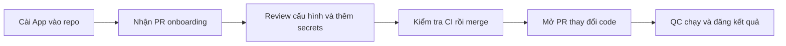

# Hướng dẫn tích hợp QC-Agent vào repository của bạn

Tài liệu dành cho chủ repository và thành viên muốn dùng QC-Agent kiểm tra Pull Request. Dịch vụ GitHub App được bên cung cấp QC-Agent vận hành sẵn; bạn bắt đầu bằng link cài App do họ cung cấp.

## 1. Bạn sẽ nhận được gì?

Sau khi cài App, QC-Agent đọc cấu trúc repository và mở một **PR cấu hình onboarding**. Bạn review cấu hình, thêm secrets cần thiết và merge. Các PR tiếp theo được GitHub Actions của repository khởi động ứng dụng, chạy kiểm tra và đăng kết quả.



Các kiểm tra có thể gồm API, lỗi bảo mật mã nguồn, secret vô tình đưa vào code và lỗ hổng dependency. Worker cụ thể phụ thuộc policy và cấu hình của project.

## 2. Chuẩn bị trước khi cài

- Link **Install GitHub App** từ bên cung cấp QC-Agent.
- Quyền cài App vào repository. Với organization, có thể cần quản trị viên phê duyệt yêu cầu install.
- GitHub Actions được phép chạy; repository có nhánh mặc định như `main` hoặc `master`.
- Biết cách build/chạy project trong môi trường test: Dockerfile, port, health endpoint, database và các biến môi trường bắt buộc.
- Có môi trường/dữ liệu/tài khoản **riêng cho test**, vì các bài kiểm tra có thể tạo hoặc sửa dữ liệu.

Khuyến nghị thử trên một repo sandbox trước khi áp dụng vào repo chính. Những project chưa có Dockerfile phù hợp hoặc có cấu trúc đặc biệt có thể cần chỉnh PR onboarding bằng tay.

## 3. Install App vào repository

1. Mở link cài App được cung cấp và đăng nhập GitHub.
2. Chọn tài khoản hoặc organization sở hữu repository.
3. Chọn **Only select repositories**, rồi chọn repo muốn tích hợp.
4. Kiểm tra quyền App yêu cầu: đọc/ghi nội dung, Pull Request và workflow; Metadata đọc. Các quyền này dùng để tạo nhánh và PR cấu hình.
5. Chọn **Install** hoặc gửi yêu cầu cho quản trị viên.

Nếu GitHub chỉ hiện yêu cầu chờ duyệt, onboarding bắt đầu sau khi người quản trị cho phép. Bên vận hành phải hỗ trợ phạm vi account/org của bạn nếu App chưa cho phép cài ngoài account sở hữu.

## 4. Mở PR onboarding

Vào tab **Pull requests** của repo, tìm PR:

```text
chore(qc): onboard QC-Agent
```

PR thường là **Draft**, trên nhánh `qc-agent/onboarding`, nhắm vào nhánh mặc định của repo.

| File/thư mục | Mục đích |
|---|---|
| `.github/workflows/qc-gate.yml` | Chạy QC cho PR và cho phép chạy thủ công |
| `.github/workflows/qc-groundtruth.yml` | Luồng sinh/kiểm tra test case nghiệp vụ, cấu hình riêng khi sử dụng |
| `.qc-agent/suites/` | Các bộ kiểm tra đề xuất cho project |
| `.qc-agent/perf/` | Kịch bản kiểm tra hiệu năng cơ bản |
| `.github/CODEOWNERS` | Người/team review cấu hình và Ground-Truth |
| `.typos.toml`, nếu được thêm | Dictionary hẹp để comment tiếng Việt tương thích công cụ spelling của repo |

Các file có đuôi `.example` là mẫu tham khảo, **chưa phải bài kiểm tra đã được cấu hình và chạy**.

PR có thể kích hoạt Actions ngay khi được mở, trước khi merge. Lần đầu đỏ do thiếu secrets hoặc cần xác nhận cấu hình là dấu hiệu cần hoàn tất onboarding; đọc lỗi của từng job để xác định nguyên nhân.

Nếu chưa thấy PR, kiểm tra tab cài đặt App có đúng repo và yêu cầu install đã được duyệt chưa. Sau đó gửi URL repo và thời điểm install cho bên hỗ trợ QC-Agent. Tránh install lại liên tục: service chống xử lý lặp và giữ PR đã mở.

## 5. Review cấu hình trước khi merge

Trong PR, tìm `qc-agent:todo` và xác nhận:

- **Dockerfile và build context** đúng với project.
- **Port** đúng với server thực tế.
- **Health URL** là đường dẫn đầy đủ, gồm prefix của router. Ví dụ `/api/v1/utils/health-check/`.
- **OpenAPI URL**, nếu kiểm tra API, đúng với SUT. Ví dụ `/api/v1/openapi.json`.
- **DB và startup**: có DB test, readiness phù hợp, chạy migration/seed trước khi test nếu project yêu cầu.
- **CODEOWNERS** trỏ tới người/team thật và có quyền phù hợp trong repository của bạn; thay owner mặc định nếu chưa đúng.

Scanner chỉ đề xuất từ cấu trúc/code tĩnh; không thể tự điền mọi quyết định triển khai. Có PR không đồng nghĩa ứng dụng đã chạy được. Với startup phức tạp, nhờ người phụ trách project hoàn thiện workflow/Dockerfile test trong chính PR này.

## 6. Thêm repository secrets

Mở repo của bạn → **Settings → Secrets and variables → Actions → New repository secret**. Nhập **Name**, dán giá trị vào **Secret**, rồi **Add secret**.

Chỉ tạo những secret project thực sự cần:

| Name | Khi nào cần? | Giá trị |
|---|---|---|
| `GHCR_PULL_TOKEN` | Image QC-Agent private và repo chưa được cấp quyền pull bằng `GITHUB_TOKEN` | PAT classic có `read:packages` của tài khoản được quyền đọc package |
| `SUT_SECRET_ENV` | Ứng dụng cần secret để chạy | Nhiều dòng `KEY=VALUE` cho môi trường test |
| `SUT_DB_SECRET_ENV` | Workflow chạy DB cần mật khẩu | Nhiều dòng `KEY=VALUE` cho container DB test |
| `QC_TEST_USERNAME`, `QC_TEST_PASSWORD` | Bộ test đã cấu hình đăng nhập bằng hai biến này | Tài khoản test có quyền phù hợp |

### Quyền kéo image private

PAT là **Personal Access Token** của GitHub. Nếu bên cung cấp đã cấp quyền package cho repo Actions của bạn, có thể dùng `GITHUB_TOKEN` sẵn có và không cần PAT riêng. Nếu cần PAT:

1. Tài khoản tạo PAT phải được phép đọc package QC-Agent. Liên hệ chủ package nếu chưa được cấp quyền.
2. GitHub cá nhân → Settings → Developer settings → Personal access tokens → **Tokens (classic)** → Generate new token.
3. Đặt tên dễ nhận diện, chọn hạn dùng và scope **`read:packages`**.
4. Copy token ngay và lưu thành `GHCR_PULL_TOKEN` trong repo SUT.
5. Xác nhận `ghcr_username` trong workflow là chủ PAT đang dùng; không giữ username của repo mẫu nếu bạn dùng PAT của người khác.

Scope `read:packages` tự nó không cấp quyền đọc package private của người khác. Bên cung cấp QC-Agent cần cung cấp image reference và cách cấp quyền phù hợp. Tham khảo [GitHub Container Registry](https://docs.github.com/en/packages/working-with-a-github-packages-registry/working-with-the-container-registry).

### Ví dụ secrets cho FastAPI + PostgreSQL

Nếu project dùng các biến này, `SUT_SECRET_ENV` có thể gồm:

```dotenv
SECRET_KEY=<chuỗi ngẫu nhiên riêng cho test>
DATABASE_URL=postgresql+psycopg://app:<mật khẩu DB test>@db:5432/app
FIRST_SUPERUSER=qc-admin@example.com
FIRST_SUPERUSER_PASSWORD=<mật khẩu admin test>
```

`SUT_DB_SECRET_ENV`:

```dotenv
POSTGRES_PASSWORD=<cùng mật khẩu DB test ở DATABASE_URL>
```

Đây là ví dụ theo framework, không phải biến bắt buộc cho mọi SUT. Các giá trị trong dấu `<...>` phải được thay trước khi dùng. Hostname `db`, user `app` và database `app` cũng phải khớp workflow của bạn. Một secret có thể chứa nhiều dòng; copy toàn bộ block đã điền vào một ô Secret.

Luôn sinh thông tin test mới. Không dùng credential production, không commit token/password, không gửi giá trị secret trong issue hoặc chat hỗ trợ.

## 7. Chạy và kiểm tra lần đầu

Sau khi sửa cấu hình/thêm secrets:

1. Vào **Actions**, chọn lượt `qc-gate` của PR onboarding.
2. Nếu lượt đó thất bại trước khi thêm secrets, chọn **Re-run jobs → Re-run failed jobs**. Hoặc push commit cấu hình mới để tạo lượt chạy mới.
3. Kiểm tra các giai đoạn: **Pull image → Start SUT/DB → Select → Gate → Review/Report → Enforce**.
4. Mở comment QC-Agent trên PR, review/inline comments và artifact của lượt chạy.

| Kết quả | Cách hiểu |
|---|---|
| `PASSED` | Các kiểm tra được chạy đáp ứng policy |
| `PASSED_WITH_WARNINGS` | Có cảnh báo theo policy; đọc nội dung cần theo dõi |
| `BLOCKED` do finding | Worker phát hiện vấn đề cần xử lý theo policy |
| Lỗi pull/build/startup | Chưa kiểm tra được SUT đầy đủ; sửa quyền hoặc cấu hình môi trường |
| `Skipped` | Job không thoả điều kiện chạy; không được hiểu là đã test và pass |

Trivy có thể quét dependency toàn repo. Vì vậy PR chỉ thêm workflow vẫn có thể bị chặn bởi CVE đã tồn tại trên nhánh mặc định; không đồng nghĩa PR onboarding đưa lỗ hổng vào. Đối chiếu finding với phạm vi thay đổi và xử lý baseline cùng người phụ trách project.

Sau khi review và xử lý kết quả theo quy định của team, chuyển PR từ Draft sang **Ready for review**, lấy review cần thiết rồi merge. Không bỏ qua finding chỉ để làm xanh CI.

## 8. Dùng QC-Agent sau onboarding

Tạo branch từ nhánh mặc định đã có cấu hình QC, sửa code và mở PR như bình thường. Actions của repo tự chạy QC và đăng kết quả; bạn không cần install lại App cho mỗi PR.

Để chạy thủ công: **Actions → qc-gate → Run workflow**, chọn branch. Nếu có input `workers`, có thể chọn worker khi chạy thủ công; PR tự động dùng selector/policy.

Muốn ngăn merge khi QC đỏ, chủ repo cần cấu hình **branch protection/ruleset**, yêu cầu đúng check QC hiển thị trên PR và review theo chính sách team. Check đỏ hoặc CODEOWNERS riêng lẻ không tự bảo đảm merge bị chặn.

Khi thử detector, dùng PR sandbox riêng, dữ liệu/credential giả và ghi rõ không merge. Sau khi thu bằng chứng, đóng PR thử nghiệm thay vì merge code lỗi cố ý vào nhánh chính.

## 9. Khi nào sinh test case bằng LLM?

Onboarding và gate không bắt buộc có LLM. Workflow `qc-groundtruth` là luồng riêng:

- PR thay đổi `.qc-agent/**`: validate Ground-Truth đã có; không sinh TC trong nhánh PR này.
- Thay đổi PRD thuộc đường dẫn đã cấu hình, mặc định `docs/prd/**`, được push/merge vào nhánh mặc định: có thể kích hoạt sinh TC.
- **Actions → qc-groundtruth → Run workflow**: kích hoạt thủ công với đường dẫn PRD.

Phải cấu hình provider/key và cho phép gửi PRD/context trước khi sinh. Test case được đề xuất ở trạng thái draft, qua PR để QA duyệt rồi gate mới dùng bản approved. Hiện luồng GT hỗ trợ Claude/Gemini; OpenAI cho GT/Selector chưa được triển khai trong mốc App này. Chưa cấu hình LLM thì job có thể được kích hoạt nhưng dừng vì thiếu key; workflow validate xanh khi chưa có catalog cũng chưa chứng minh đã sinh test.

## 10. Lỗi thường gặp và thông tin gửi hỗ trợ

| Hiện tượng | Việc cần kiểm tra |
|---|---|
| Không có PR onboarding | Install được duyệt, đúng repo; liên hệ bên vận hành kiểm tra webhook/service |
| PR đã có nhưng thay đổi không tự cập nhật | Service giữ PR đang mở để bảo vệ chỉnh sửa của bạn; nhờ hỗ trợ cập nhật, không chờ install lại tự ghi đè |
| Pull image báo 401 / `manifest unknown` | Image/digest, package access, PAT chưa hết hạn, `GHCR_PULL_TOKEN`, username |
| Start SUT lỗi | Đọc log: thiếu env, DB chưa sẵn sàng, migration, Dockerfile/context, port hoặc health URL |
| Gate đỏ vì CVE | Đọc package/version/fixed version trong evidence; cập nhật dependency và lockfile theo quy trình team |
| Chỉ một số worker chạy | Kiểm tra selector/policy và phạm vi PR; không mặc định mọi worker đều phải chạy |
| Không merge được dù checks xanh | PR còn Draft, thiếu review, conflict hoặc branch rules khác |
| Workflow sinh test thiếu key | Chưa cấu hình provider/key; liên hệ bên cung cấp trước khi bật gửi PRD ra LLM |

Khi cần hỗ trợ, gửi **URL repo, URL PR, URL workflow run, tên bước lỗi và log đã che thông tin nhạy cảm**. Không gửi PAT, private key App, mật khẩu DB hoặc nội dung repository secrets.

## 11. Checklist hoàn tất tích hợp

- [ ] App được install vào đúng SUT và đã có PR onboarding.
- [ ] Dockerfile/context, port, health/OpenAPI, startup/DB và TODO được xác nhận.
- [ ] Secrets test và quyền pull image đã đủ; QA owner phù hợp với repo.
- [ ] CI khởi động SUT và chạy worker; có review/report/evidence.
- [ ] Baseline/finding đã được team xem xét; không nhầm skipped với pass.
- [ ] PR onboarding được review và merge.
- [ ] PR tiếp theo tự chạy QC.
- [ ] Required checks/QA review được cấu hình nếu team yêu cầu chặn merge.

Tài liệu cho bên vận hành App/service nằm riêng tại [github-app-setup.md](github-app-setup.md).
